<div align="center">

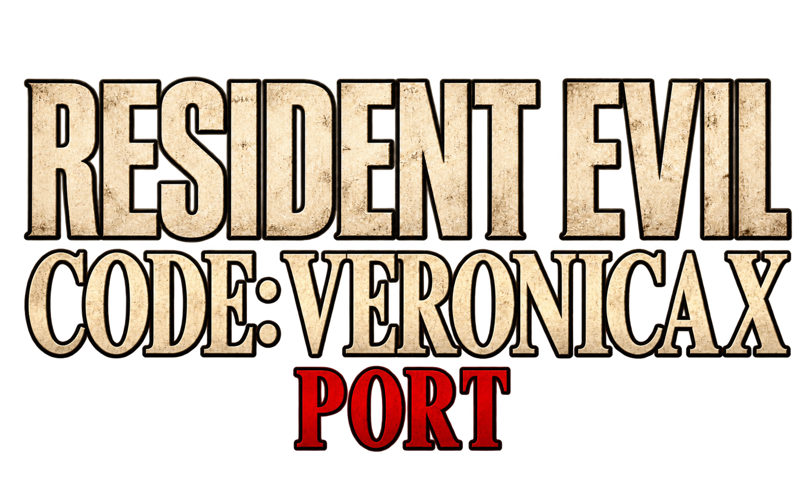

# Resident Evil Code: Veronica X — Port para PC

**Port nativo y no oficial de la versión de PlayStation 3 para Windows, hecho por recompilación estática.**

[English](README.md) | [Português (Brasil)](README.pt-BR.md) | **Español**

</div>

> [!IMPORTANT]
> **No se incluye ningún archivo del juego.** Este repositorio y sus lanzamientos contienen solo el port: ningún dato del juego, ningún ejecutable del juego y ningún código generado a partir de él. Necesitas tu **propia copia original** del juego de PS3 (versión de PSN). *Resident Evil*, *Code: Veronica* y todos los nombres, personajes e imágenes relacionados son marcas y derechos de autor de **Capcom**. Es un proyecto de fans. **No está afiliado, autorizado ni respaldado por Capcom ni por Sony Interactive Entertainment**.

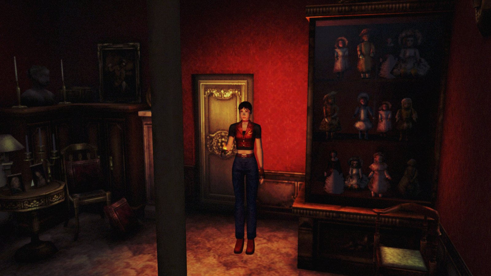

## Índice

- [Qué es](#qué-es)
- [Por qué la versión de PS3](#por-qué-la-versión-de-ps3)
- [Versiones compatibles](#versiones-compatibles)
- [Requisitos](#requisitos)
- [Preparar el juego](#preparar-el-juego)
- [Instalar y jugar](#instalar-y-jugar)
- [Funciones](#funciones)
  - [Parches](#parches)
  - [Mods de texturas](#mods-de-texturas-experimental)
- [Atajos](#atajos)
- [Capturas de pantalla](#capturas-de-pantalla)
- [Problemas conocidos](#problemas-conocidos)
- [Compilar el código](#compilar-el-código)
- [Ejecutar las pruebas](#ejecutar-las-pruebas)
- [Organización del repositorio](#organización-del-repositorio)
- [Créditos](#créditos)
- [Licencia](#licencia)

## Qué es

Es un port nativo para Windows x64 de **Resident Evil Code: Veronica X** de PlayStation 3. No es un emulador. El código PowerPC (PPU) y SPU del juego se traduce por adelantado a C/C++ con [ps3recomp](https://github.com/sp00nznet/ps3recomp) y después se compila como un ejecutable normal de Windows. Las bibliotecas del sistema de PS3 están reimplementadas y los gráficos del RSX funcionan sobre Direct3D 12.

Además, el port tiene su propio launcher, opciones gráficas modernas, 60 FPS, generación de fotogramas, un SRT listo para speedrun, herramientas de práctica y más. Todo se describe abajo.

## Por qué la versión de PS3

Soy muy fan de Resident Evil y de Capcom, y Code: Veronica es uno de mis juegos favoritos de la saga. Elegí la versión de PS3 porque es la que usan muchos **speedrunners**, y quería que tuvieran una versión de PC rápida, estable y con herramientas pensadas para practicar: vida, inventario, enemigos y tiempo en pantalla, y la posibilidad de ir a cualquier sala.

El port es para **todos los jugadores**: quienes quieren volver a jugarlo con más resolución, 60 FPS y mandos modernos, y también quienes lo corren de forma competitiva.

## Versiones compatibles

Solo son compatibles las **versiones de PSN, 01.00**. Cada región tiene su ejecutable; todos comparten el mismo launcher, ajustes, partidas guardadas y cachés, y cualquiera de ellos abre el ejecutable correcto para la carpeta elegida.

| Región | Código | Ejecutable | Licencia (.rap) |
|---|---|---|---|
| Europa | `NPEB00553` | `CodeVeronicaPort.exe` | Necesaria |
| Estados Unidos | `NPUB30467` | `CodeVeronicaPort_US.exe` | Necesaria |
| Japón (*BIOHAZARD CODE: Veronica Kanzenban*) | `NPJB00135` | `CodeVeronicaPort_JP.exe` | No hace falta |

Las actualizaciones del juego, las versiones en disco y otras versiones no funcionan. El launcher comprueba la versión y avisa si la carpeta no es compatible.

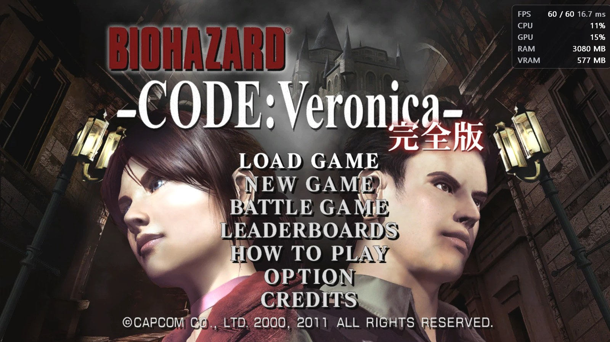

## Requisitos

- Windows 10 u 11, de 64 bits.
- Tarjeta gráfica compatible con **Direct3D 12**.
- El **Microsoft Visual C++ Redistributable (x64)**. Sin él, Windows avisa de que falta `MSVCP140.dll` o `VCRUNTIME140.dll`.
- Tu copia del juego, en carpeta (ver abajo).

**No hace falta firmware de PS3 ni RPCS3 para jugar.**

### PC de pruebas

El port se desarrolló y probó en este PC, donde el juego se **completó de principio a fin**:

| Componente | Modelo |
|---|---|
| Procesador | AMD Ryzen 5 5600X |
| Tarjeta gráfica | AMD Radeon RX 6700 XT 12 GB |
| Memoria | 32 GB DDR4 |

Otros PC deberían funcionar, pero esta es la configuración que se probó realmente.

## Preparar el juego

El port lee el juego desde una **carpeta**, no desde un archivo `.pkg`. Funciona como los ports de PS4 que usan carpetas de juego al estilo de shadPS4: el PKG debe **instalarse o extraerse antes**. Un `.pkg` no se puede abrir directamente.

La carpeta elegida debe tener `PARAM.SFO` y `USRDIR\EBOOT.BIN`:

```
NPEB00553\            (o NPUB30467 / NPJB00135)
├── PARAM.SFO
├── ICON0.PNG
└── USRDIR\
    ├── EBOOT.BIN
    └── BHCV\ ...
```

**Paso a paso**

1. **Obtén la carpeta del juego a partir de tu PKG.** Lo más fácil es instalar el PKG en [RPCS3](https://rpcs3.net) (*File → Install Packages/Raps/Edats*). La carpeta queda en `RPCS3\dev_hdd0\game\NPEB00553` (o `NPUB30467` / `NPJB00135`). Cualquier herramienta de extracción de PKG de PS3 que genere la misma carpeta también sirve. RPCS3 solo se usa aquí para desempaquetar el juego; el port no lo necesita después.
2. **Busca tu licencia (`.rap`)** para las versiones europea y americana. Es el archivo `.rap` de la cuenta que compró el juego. En RPCS3 está en `dev_hdd0\home\00000001\exdata`, con el código del juego en el nombre (por ejemplo `EP0102-NPEB00553_00-…​.rap`). Si el `.rap` está dentro de la carpeta del juego, el launcher lo encuentra solo. **La versión japonesa no necesita `.rap`.**
3. **Deja los archivos originales como están.** No hace falta descifrar nada: la primera vez, el port descifra el `EBOOT.BIN` con tu licencia en su propia carpeta `eboot_cache` (tarda menos de un segundo). Los archivos del juego nunca se modifican.

## Instalar y jugar

1. Instala el [Visual C++ Redistributable (x64)](https://aka.ms/vs/17/release/vc_redist.x64.exe) si aún no lo tienes.
2. Extrae el ZIP completo en una carpeta donde puedas escribir, por ejemplo `C:\Juegos\CodeVeronica`. No lo ejecutes desde dentro del ZIP ni desde `Archivos de programa`, y mantén todos los archivos juntos.
3. Abre `CodeVeronicaPort.exe` (cualquiera de los tres ejecutables abre el mismo launcher).
4. En la página **Juegos**, añade la carpeta de cada versión que tengas y, en la europea y la americana, el `.rap` si no se encontró solo.
5. Elige la versión, ajusta los gráficos y los controles y pulsa **JUGAR**.

En las primeras partidas puede haber pequeños tirones mientras se compilan los shaders. Se guardan en `shader_cache` y no se vuelven a compilar.

**Dónde está cada cosa** (todo dentro de la carpeta del port): ajustes en `cv_launcher.ini`; partidas guardadas en `gamedata\dev_hdd0\` (se puede elegir otra carpeta en el launcher); cachés en `shader_cache\` y `eboot_cache\` (se pueden borrar, se rehacen); capturas en `screenshots\`; el registro de la última sesión en `run-log.txt`, útil para informar de un problema.

El launcher también puede buscar nuevas versiones en los lanzamientos de GitHub y actualizarse (se puede desactivar en el launcher).

## Funciones

### Launcher

- Launcher propio en **13 idiomas**: Português (Brasil), English, Español, 日本語, Français, Deutsch, Italiano, Polski, Türkçe, العربية, 简体中文, 한국어 y Русский.
- Biblioteca con las tres regiones, comprobación de la versión y de la licencia, y la bandera de cada región.
- Sigue abierto durante el juego como **menú de opciones** (`Insert`/`F5`), para cambiar ajustes sin salir de la partida.
- Páginas: Juegos, Gráficos, Partidas y capturas, Controles, Atajos, Parches, Mods, SRT, Trucos, Rendimiento y Avanzado (idioma, caché de shaders, visor del registro del juego).
- Pausa opcional cuando la ventana del juego pierde el foco.

### Gráficos y rendimiento

- **Resolución de renderizado**: 480p, 720p nativa, 1080p, 1440p y **4K** (3840×2160). En ventana, ventana sin bordes o pantalla completa.
- **Antialiasing**: FXAA (ligero) o SMAA (mejor).
- **Filtrado anisotrópico**: 2x, 4x, 8x y 16x.
- **Nitidez** con **AMD FSR 1 RCAS**, del 10% al 100%.
- **Límite de fotogramas**:
  - **30 FPS (original)**: la misma experiencia que en PS3, donde el juego va a 30 FPS.
  - **60 FPS**: la lógica del juego sigue a sus 30 Hz originales y los fotogramas extra salen de la **interpolación de las poses** de personajes y objetos, así que se mantiene el ritmo del juego. La interpolación usa la CPU por defecto, con un modo experimental en la GPU. Si el PC no mantiene los 60 FPS, el juego va más lento.
- **AMD FSR 3.1 Frame Generation** (opcional, solo en el modo 60 FPS): hasta 120 FPS cuando el PC mantiene los 60 FPS.
- **VSync** (modo 60 FPS): la imagen no se corta. No se puede usar junto con la generación de fotogramas.
- Indicador de rendimiento con FPS, tiempo de fotograma, CPU, GPU, RAM, VRAM y carga de SPU/RSX, en cualquier esquina.
- Caché persistente de shaders y pipelines, cargada en segundo plano, con aviso opcional del progreso.
- Vídeos (FMV) decodificados con FFmpeg y audio ATRAC3plus decodificado en el propio port: no hace falta firmware de PS3.

### SRT para speedrunners

| | |
|---|---|
| 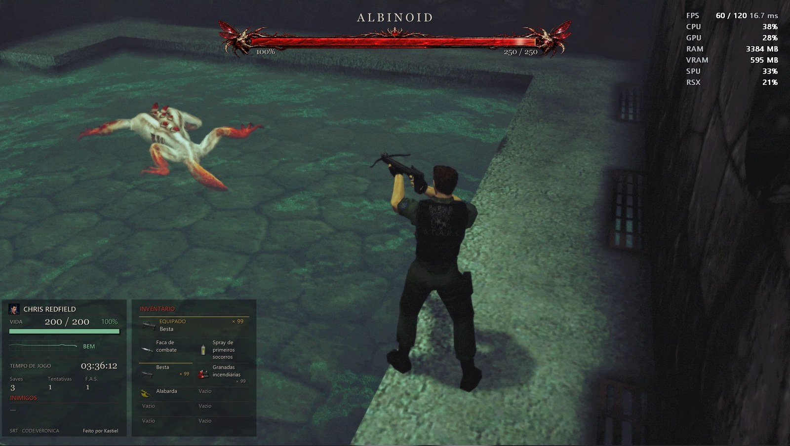 | 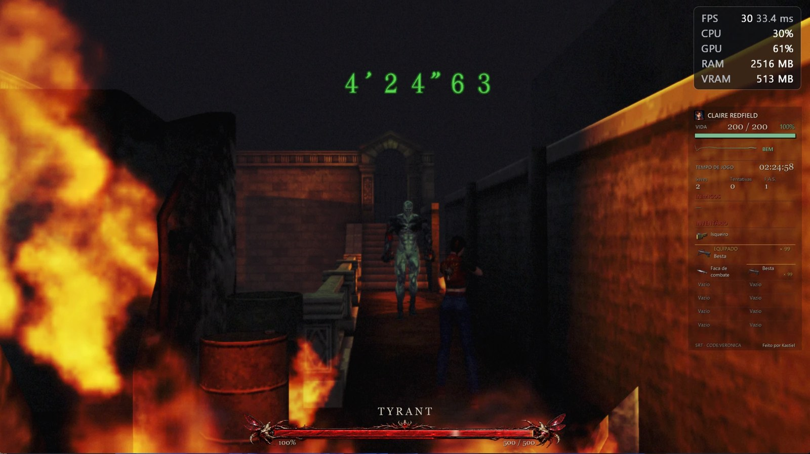 |
| 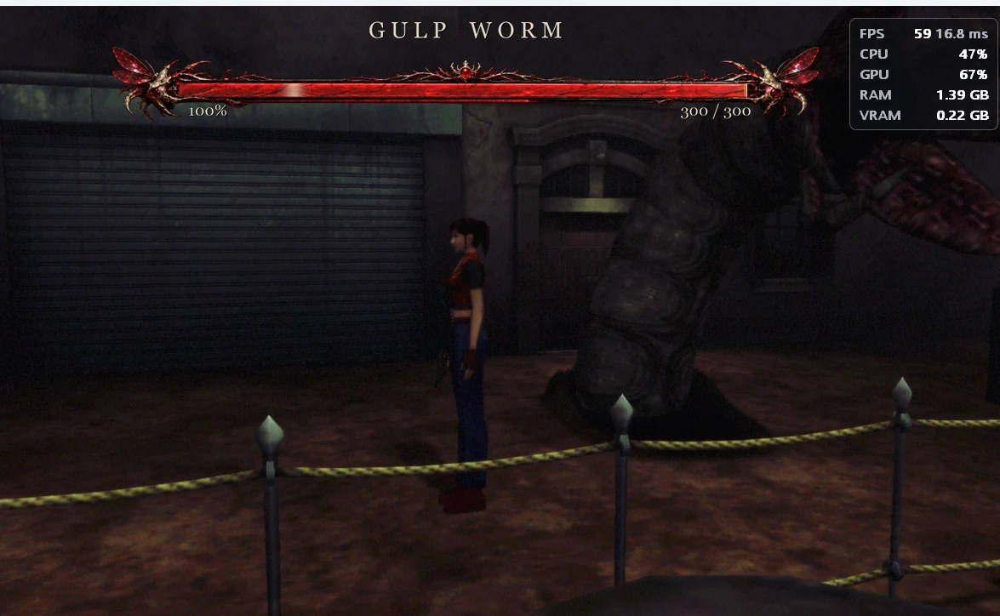 | 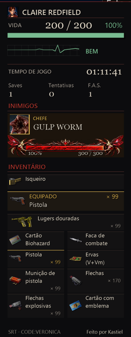 |

Un **SRT** (speedrun tool) nativo, dibujado por el propio juego, que se activa y desactiva con `F8`:

- Nombre y retrato del personaje, **vida** (valor, porcentaje y estado: bien, cuidado, peligro, envenenado, gas).
- **Tiempo de juego**, partidas guardadas, reintentos y sprays de primeros auxilios (F.A.S.).
- **Enemigos** con barra de vida y retrato, y **barras de vida de los jefes** (en el panel o centradas arriba o abajo).
- **Inventario** con el arma equipada, la munición y los iconos originales de los objetos, leídos de los archivos de tu juego.
- Cualquier esquina, disposición en fila o columna, inventario al lado o debajo, tamaño del 50% al 200%, opacidad del fondo, borde, idioma del panel, o una **ventana separada** que puedes colocar donde quieras (por ejemplo en un segundo monitor o en OBS).
- En `projects/code_veronica/livesplit/` se incluye un autosplitter de **LiveSplit** que también reconoce el port.

### Herramientas de práctica, partidas y objetos

- Ventana **Archivos** (`F7`, se activa en Avanzado): **cargar cualquier sala o mapa** (con el punto de entrada de la sala) para practicar un tramo, **guardar en cualquier lugar** en una biblioteca de partidas independiente, con miniaturas, y **cargar** esas partidas cuando quieras.
- **Menú de objetos** (`F6`, se activa en Trucos): pon cualquier objeto o arma en el inventario del personaje actual, o quítalo, sin salir de la partida.
- **Trucos**: vida infinita y munición infinita, que se activan y desactivan durante el juego.
- **Parches**: saltar la animación de las puertas, saltar los logos y la introducción, y tus propios parches en el formato `patch.yml` de RPCS3.
- Elección de la carpeta de las partidas guardadas.

### RECOMP SETTINGS dentro del juego

En el propio menú **OPTION** del juego, la página **RECOMP SETTINGS** cambia el antialiasing, la nitidez, el filtrado anisotrópico, el brillo, el contraste y la saturación sin abrir el launcher. Su página **APPEARANCE** cambia el modelo del personaje: Claire (traje original y alternativo), Chris, Steve, Wesker, 26 variantes de zombi y dos formas de Alexia, con una vista previa giratoria. Es solo visual; la historia y la partida no cambian.

### Controles

- Mandos de **Xbox** (XInput), **PlayStation** (DualShock 4 y DualSense) y **Nintendo Switch**, además del teclado, todos a la vez.
- **Vibración** con intensidad ajustable (0–200%).
- Cualquier tecla o botón se puede reasignar, con varias teclas por acción.
- Iconos de botones en pantalla en HD para PlayStation, Xbox, Switch o teclado, elegidos automáticamente según el último dispositivo usado.

### Parches

La página **Parches** muestra cambios en el propio código del juego. Se aplican al momento, incluso con el juego abierto.

- **Saltar la animación de las puertas**: la siguiente sala carga directamente, sin la animación de la puerta abriéndose (de Kapdap, de la lista de parches de RPCS3).
- **Saltar logos e introducción**: el juego abre directamente en la pantalla de título, sin los logos de CAPCOM / MT FRAMEWORK ni el vídeo de introducción.
- **Tus propios parches**: elige una carpeta con archivos de parche `.yml` de RPCS3 (el mismo formato que `patch.yml` de RPCS3). Los parches de tu versión del juego aparecen en la lista, cada uno con su interruptor. Un parche que cambia código que no viene compilado en esta versión aparece como no disponible.

### Mods de texturas (experimental)

El port puede **sustituir las texturas del juego por imágenes PNG** y también **extraer las texturas originales** por ti, ya con el nombre correcto. Todo está en la página **Mods** del launcher.

**Cómo funcionan los nombres.** Cada textura tiene un código: 16 caracteres hexadecimales al principio del nombre del archivo, por ejemplo

```
1A2B3C4D5E6F7081_512x256_DXT5.png
└──── código ──┘ └tam.┘ └formato┘
```

Solo importa el **código**. El PNG nuevo puede tener **cualquier tamaño** (una textura de 512×256 puede pasar a 2048×1024 en HD) y el resto del nombre es libre, pero debe **empezar por el mismo código**. Solo se leen archivos `.png`.

**Paso 1 — Extrae las texturas** (para saber el código de cada una)

1. Abre el launcher y ve a **Mods**.
2. Elige un modo de extracción:
   - **Extraer texturas de todos los mapas**: lee los archivos del juego sin jugar. Selecciónalo y pulsa **Iniciar extracción**. Tarda unos minutos, muestra el progreso y se puede cancelar. Un archivo CSV indica de qué archivo del juego salió cada PNG.
   - **Extraer texturas de salas visitadas**: actívalo y juega; cada textura nueva que aparece (salas, personajes, objetos, efectos) se guarda. Úsalo para las imágenes que el juego crea mientras se ejecuta, que no están guardadas en los archivos.
3. Los PNG van a la **Carpeta de texturas extraídas** (por defecto `mods\texture-dumps\<versión>`, junto al ejecutable). Los PNG que ya existen nunca se sobrescriben, así que tus ediciones están a salvo.

**Paso 2 — Crea el mod**

1. Copia los PNG que quieras cambiar y edítalos (o amplíalos) en cualquier editor de imágenes.
2. **Conserva el código al principio del nombre.** El tamaño puede cambiar.
3. Colócalos en la **Carpeta de texturas del mod** (por defecto `mods\textures`), dentro de la subcarpeta de tu versión: `NPEB00553`, `NPUB30467` o `NPJB00135`. Sin subcarpeta, la propia carpeta sirve para todas las versiones. Puedes crear subcarpetas dentro para organizar el pack como quieras.

**Paso 3 — Úsalo**

1. Activa **Reemplazar texturas** en la página Mods (reinicia el juego si cambiaste la carpeta del mod).
2. En el juego, pulsa **F9** (mando: R1+R2+L1+L2+□ / RB+RT+LB+LT+X) para comparar el mod con las texturas originales cuando quieras.
3. Los packs grandes no ocupan memoria de entrada: cada PNG solo se carga cuando su textura aparece en pantalla.

> [!TIP]
> **Usar packs de texturas HD de PS2.** Los packs de texturas HD hechos para la versión de PS2 de Code: Veronica suelen funcionar, porque las texturas son las mismas, pero **los nombres de los archivos son distintos**: cada archivo debe **renombrarse con el código de PS3** de la textura correspondiente. Extrae las texturas con **Extraer texturas de todos los mapas**, busca el PNG extraído que muestra la misma imagen que el archivo de PS2 y renombra el archivo de PS2 con el nombre de ese PNG (al menos el código de 16 caracteres). Después colócalo en la carpeta del mod como en el Paso 2.

Notas: las caras de los cubemaps (reflejos) se extraen en `reference\cubemaps` solo como referencia; por ahora la sustitución funciona con texturas 2D. No compartas nunca las texturas originales extraídas; comparte solo las imágenes que tú hayas editado.

## Atajos

En el mando, mantén primero los cuatro botones superiores y después pulsa el último botón.

| Teclado | PlayStation | Xbox | Switch | Qué hace |
|---|---|---|---|---|
| `Insert` / `F5` | R1+R2+L1+L2+L3 | RB+RT+LB+LT+LS | R+ZR+L+ZL+LS | Menú de opciones (pantalla, audio, SRT, salir) |
| `F6` | R1+R2+L1+L2+△ | RB+RT+LB+LT+Y | R+ZR+L+ZL+X | Menú de objetos (activar en Trucos) |
| `F7` | R1+R2+L1+L2+○ | RB+RT+LB+LT+B | R+ZR+L+ZL+A | Archivos: mapas, guardar, cargar (activar en Avanzado) |
| `F8` | R1+R2+L1+L2+✕ | RB+RT+LB+LT+A | R+ZR+L+ZL+B | Muestra u oculta el SRT |
| `F9` | R1+R2+L1+L2+□ | RB+RT+LB+LT+X | R+ZR+L+ZL+Y | Activa/desactiva las texturas del mod |
| `F10` | R1+R2+L1+L2+R3 | RB+RT+LB+LT+RS | R+ZR+L+ZL+RS | Captura de pantalla (en `screenshots\`) |

Teclado por defecto, sin mando: flechas = cruceta, `X` = Cruz, `Z` = Círculo, `A` = Cuadrado, `S` = Triángulo, `I` = Start, `R` = Select. Todo se puede cambiar en la página Controles.

## Capturas de pantalla

| | |
|---|---|
| 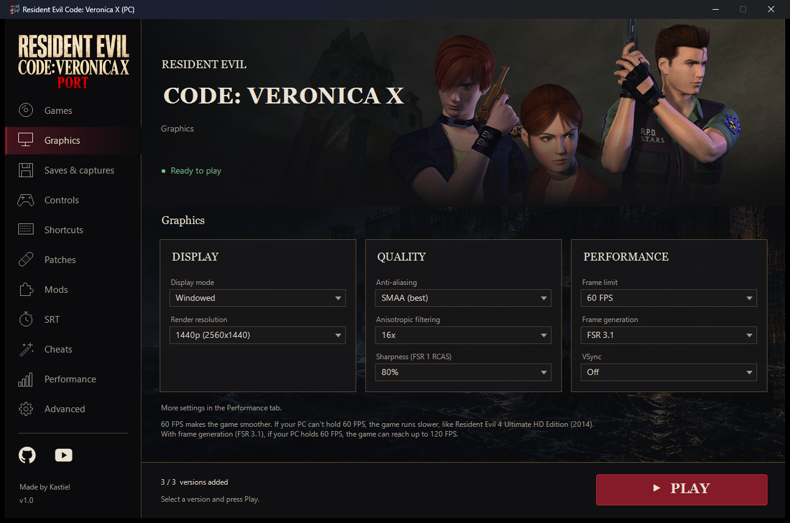 | 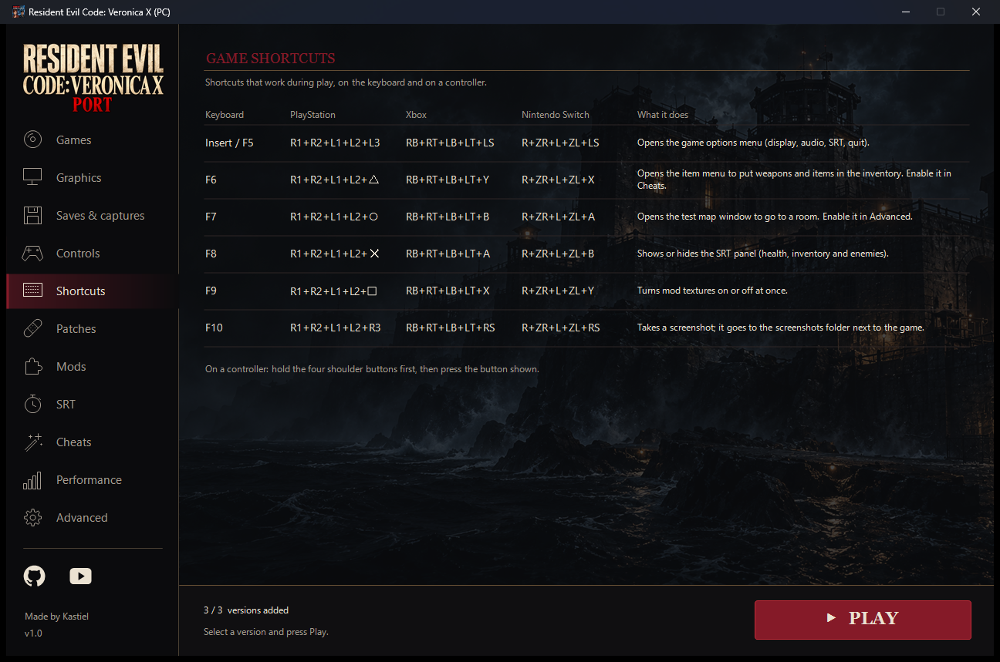 |
| 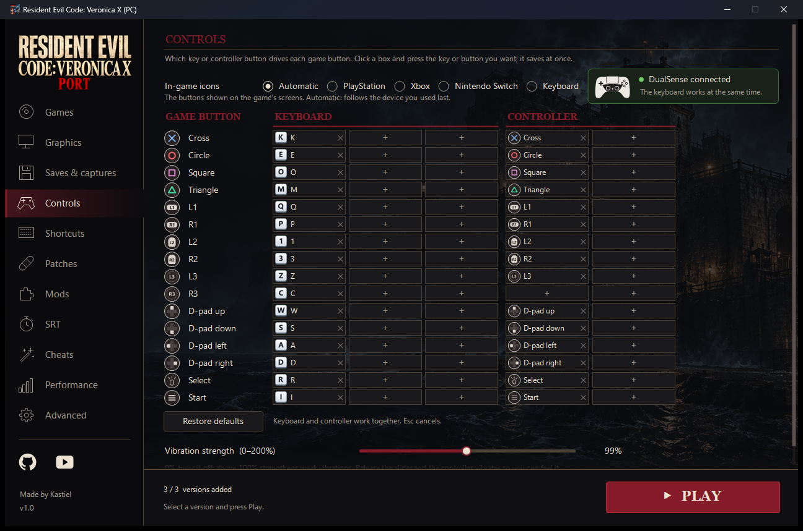 | 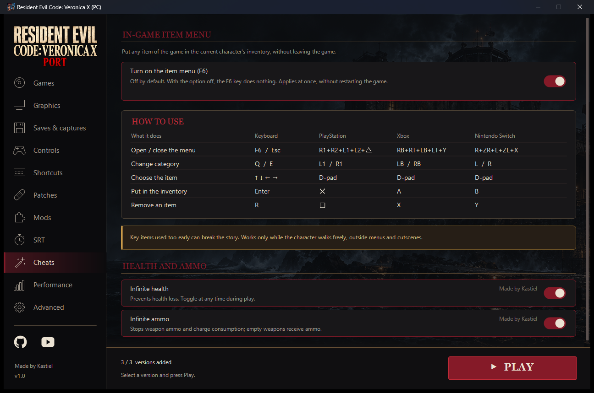 |
| 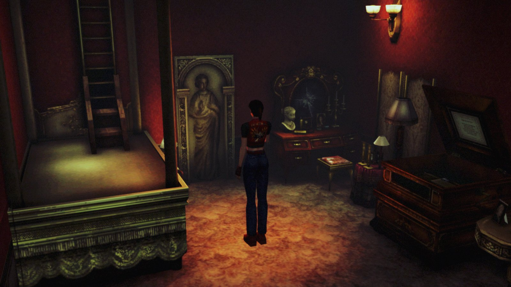 | 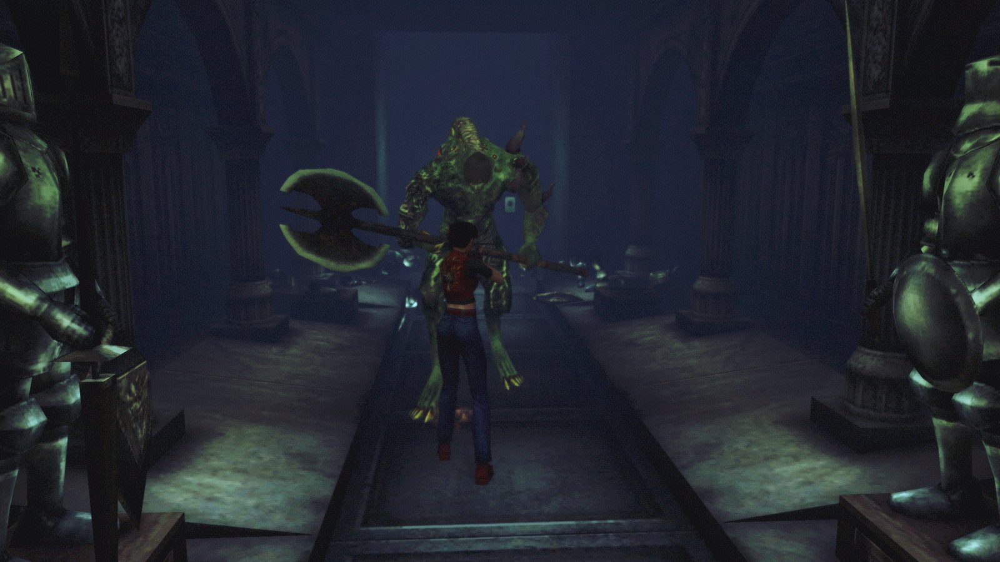 |
| 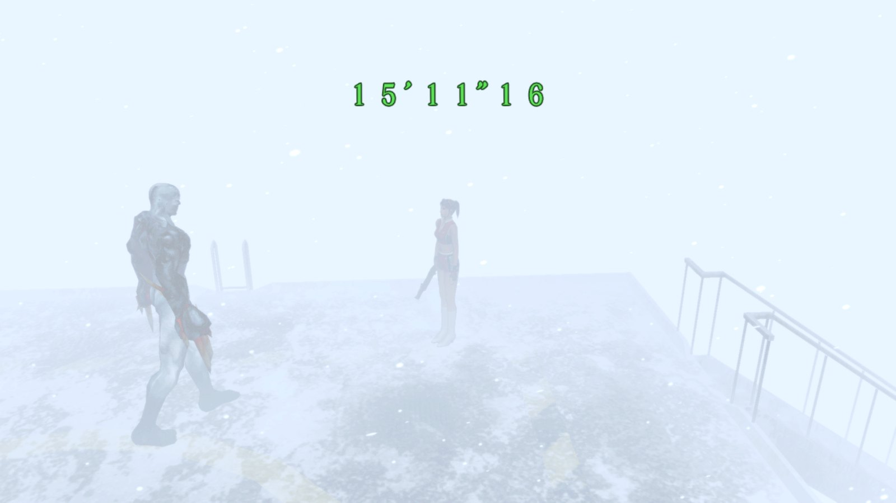 | 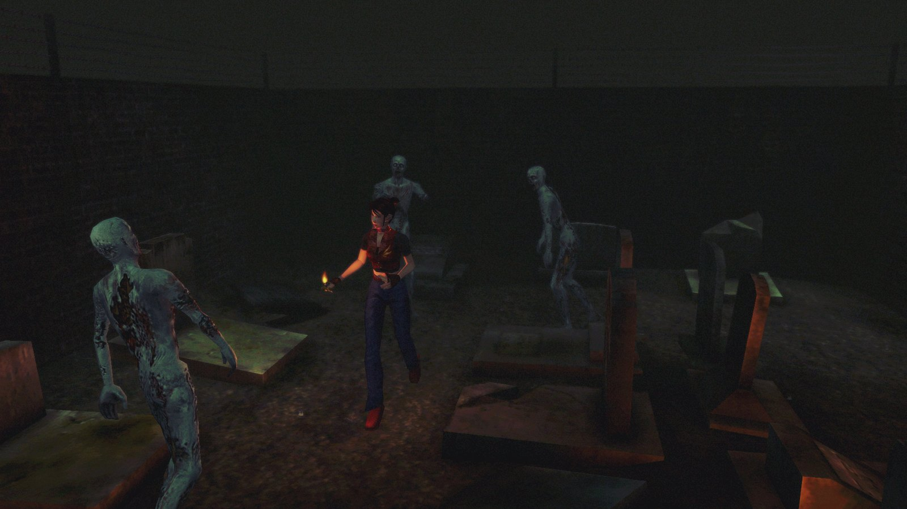 |
| 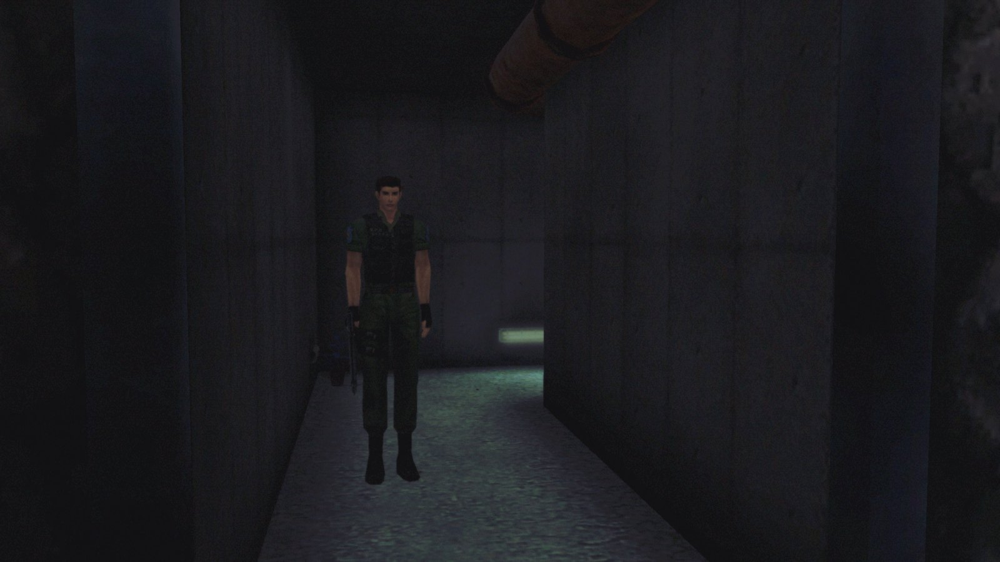 | 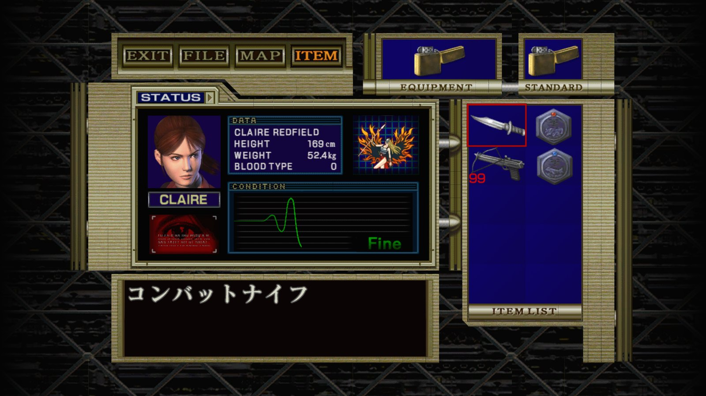 |
| 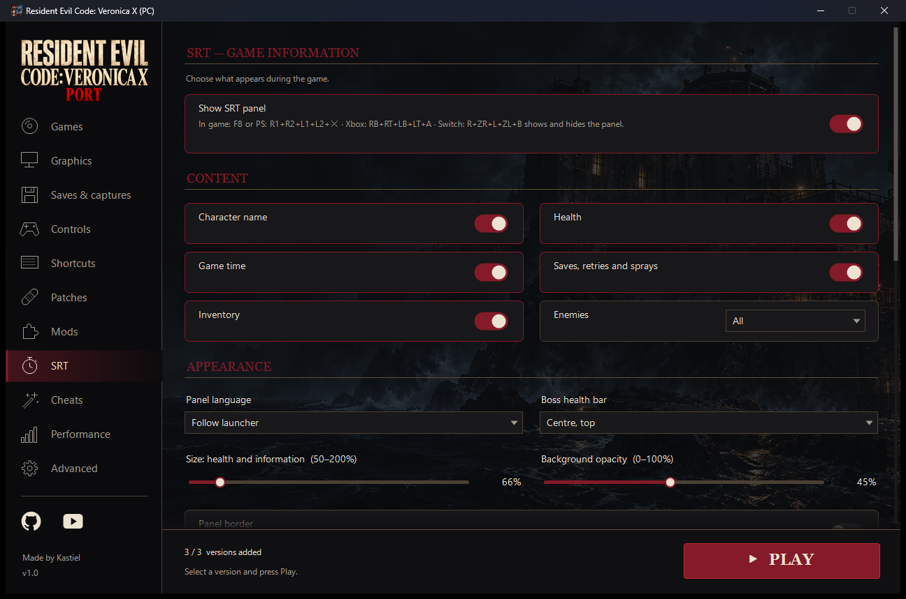 | |

## Problemas conocidos

El port sigue en desarrollo. Todavía pueden aparecer fallos gráficos y de iluminación, los 60 FPS no están garantizados en todos los PC, y la mayoría de las pruebas de juego se hicieron en la versión japonesa (la europea y la americana comparten el mismo código). Informa de los problemas con tu `run-log.txt` y una descripción de lo que pasó.

## Compilar el código

Solo hace falta compilar para trabajar en el port. Necesitas tu propio juego descifrado, porque el código recompilado del juego se genera en tu equipo y **nunca se sube al repositorio**.

**Herramientas:** Visual Studio 2022 o posterior (o Build Tools) con la carga de trabajo de C++, **LLVM/clang-cl**, CMake 3.20+, Ninja, Python 3.12 y las DLL de FFmpeg 7.1 (`avcodec-61`, `avutil-59`, `swscale-8`, `swresample-5`) en `third_party/ffmpeg/bin/`.

1. **Genera el código del juego.** Sigue [docs/GETTING_STARTED.md](docs/GETTING_STARTED.md) y [docs/SPU_LIFTER.md](docs/SPU_LIFTER.md) para generar el código PPU en `src/recomp/` (EU), `src/recomp_us/` (US) y `src/recomp_jp/` (JP), y las imágenes SPU en `projects/code_veronica/spu/`. Por ejemplo, para la japonesa:
   ```
   python tools/ppu_loader.py <NPJB00135>/USRDIR/EBOOT.elf -o out_jp/
   python tools/ppu_lifter.py <NPJB00135>/USRDIR/EBOOT.elf --functions out_jp/EBOOT.functions.json --hle-stubs out_jp/EBOOT.imports.json --patches projects/code_veronica/patches.json -o src/recomp_jp
   ```
2. **Compila.** Ejecuta `projects/code_veronica/build-release.cmd` (Europa). Define `CV_BUILD_JP=1` y/o `CV_BUILD_US=1` para compilar las otras regiones en la misma ejecución, o usa `build-release-jp.cmd` solo para la japonesa. Los scripts tienen las rutas del autor (Visual Studio, LLVM y `D:/ps3recomp`); ajústalas a tu equipo.
3. Los ejecutables quedan en `projects/code_veronica/build-release/bin/`. Usa siempre la compilación Release: la Debug es demasiado lenta para el código recompilado.
4. `projects/code_veronica/empacotar-release.cmd` crea el ZIP de lanzamiento (solo los archivos del port, nunca datos del juego).

## Ejecutar las pruebas

Las pruebas se ejecutan bajo demanda con `build-release.cmd`, mediante variables de entorno. Usan datos sintéticos y carpetas temporales, nunca tus partidas ni tus ajustes. Ejemplo:

```
set CV_SRT_TESTS=1
set CV_UPDATER_TESTS=1
projects\code_veronica\build-release.cmd
```

| Variable | Qué comprueba |
|---|---|
| `CV_SRT_TESTS` | Lectura de memoria del SRT, diseño y atajos del mando (EU, y JP/US con `CV_BUILD_JP`/`CV_BUILD_US`) |
| `CV_MAP_TESTS` | Herramientas de mapas/salas |
| `CV_ITEMS_TESTS` | Reglas del menú de objetos (F6) y escritura en la memoria del juego, por región |
| `CV_CHEAT_TESTS` | Trucos en las tres regiones |
| `CV_SAVE_TESTS` | Biblioteca de partidas, en carpetas aisladas |
| `CV_MENU_TESTS` | Navegación del menú RECOMP SETTINGS |
| `CV_FPS_TESTS`, `CV_POSE_TESTS`, `CV_POSE_GPU_TESTS` | Reloj de 30/60 FPS e interpolación de poses |
| `CV_UPDATER_TESTS` | Actualizador del launcher, sin red |
| `CV_FOCUS_PAUSE_TESTS` | Pausa al perder el foco |
| `CV_FP_TESTS`, `CV_DXC_TESTS`, `CV_SHADOW_FILTER_TESTS` | Traducción de shaders y filtros |
| `CV_SPU_FAULT_TESTS`, `CV_SPU_POOL_TESTS`, `CV_SPU_SCHEDULE_TESTS` | Runtime de SPU |

Los demás objetivos de prueba (por ejemplo `code_veronica_launcher_cache_tests`) están en `projects/code_veronica/CMakeLists.txt` y se compilan con `cmake --build build-release --target <nombre>`.

## Organización del repositorio

| Ruta | Contenido |
|---|---|
| `projects/code_veronica/` | El port: launcher, SRT, herramientas, enganches del renderizador, scripts de compilación y notas de diseño |
| `projects/code_veronica/livesplit/` | Autosplitter de LiveSplit con soporte para el port |
| `runtime/`, `libs/`, `tools/`, `include/` | El runtime de ps3recomp, las bibliotecas de PS3 reimplementadas y las herramientas del recompilador |
| `third_party/` | FFmpeg, decodificador ATRAC3, SMAA y AMD FSR 3.1 |
| `docs/` | Documentación de ps3recomp y las imágenes de este README |
| [README-ps3recomp.md](README-ps3recomp.md) | El README original de ps3recomp |

## Créditos

**Port:** hecho por **Kastiel**.

**Ayuda en el desarrollo:** el port se desarrolló con ayuda de asistentes de IA: **Claude** (Anthropic) y **Codex** (OpenAI).

**Base**
- [ps3recomp](https://github.com/sp00nznet/ps3recomp), de **sp00nznet (Ned Heller)** y sus [colaboradores](CONTRIBUTORS.md): el kit de recompilación estática y el runtime sobre los que se construyó el port (MIT).
- [RPCS3](https://rpcs3.net): el emulador de PS3, usado como referencia del comportamiento del hardware y del sistema, en las comparaciones fotograma a fotograma y por su formato `patch.yml`.

**Bibliotecas y recursos**
- [FFmpeg](https://ffmpeg.org) (LGPL 2.1 o posterior): decodificación de los vídeos MPEG-2.
- Decodificador ATRAC3/ATRAC3plus de FFmpeg, en la versión separada por [PPSSPP](https://github.com/hrydgard/ppsspp) (`at3_standalone`, LGPL 2.1 o posterior).
- [AMD FidelityFX FSR 3.1](https://gpuopen.com/fidelityfx-super-resolution-3/), runtime de generación de fotogramas (licencia de AMD), y AMD FSR 1 RCAS/EASU.
- [SMAA](https://www.iryoku.com/smaa/), de Jorge Jimenez, Jose I. Echevarria, Belen Masia, Fernando Navarro y Diego Gutierrez (MIT).
- FXAA 3.11, de Timothy Lottes (NVIDIA).
- [stb_image y stb_image_write](https://github.com/nothings/stb), de Sean Barrett (dominio público / MIT).
- [GitHub Octicons](https://github.com/primer/octicons) (MIT), para el símbolo de GitHub en el launcher.

**Comunidad de Resident Evil**
- **Kapdap**: [re-cvx-srt-provider](https://github.com/kapdap/re-cvx-srt-provider) (MIT), cuyas direcciones de memoria y reglas de estado del juego se estudiaron para el SRT; el [autosplitter de Code: Veronica](https://github.com/kapdap/re-cvx-autosplitter) (MIT), que amplía el script de LiveSplit incluido; y el parche para saltar las puertas de la lista de parches de RPCS3.
- **aikatore y colaboradores**: [recvx-enhanced-port](https://github.com/aikatore/recvx-enhanced-port) (MIT), por los nombres de las salas y como referencia para los fotogramas intermedios.

**Capcom** creó *Resident Evil Code: Veronica*. Apoya los lanzamientos oficiales.

Los textos completos de las licencias están en [THIRD-PARTY-NOTICES.md](THIRD-PARTY-NOTICES.md).

## Licencia

El código del port y ps3recomp se distribuyen bajo la **Licencia MIT**: consulta [LICENSE](LICENSE). Los componentes de terceros mantienen sus propias licencias, listadas en [THIRD-PARTY-NOTICES.md](THIRD-PARTY-NOTICES.md). La licencia no cubre el juego: *Resident Evil Code: Veronica X* y sus recursos pertenecen a Capcom, y necesitas tener el juego para usar este port.
